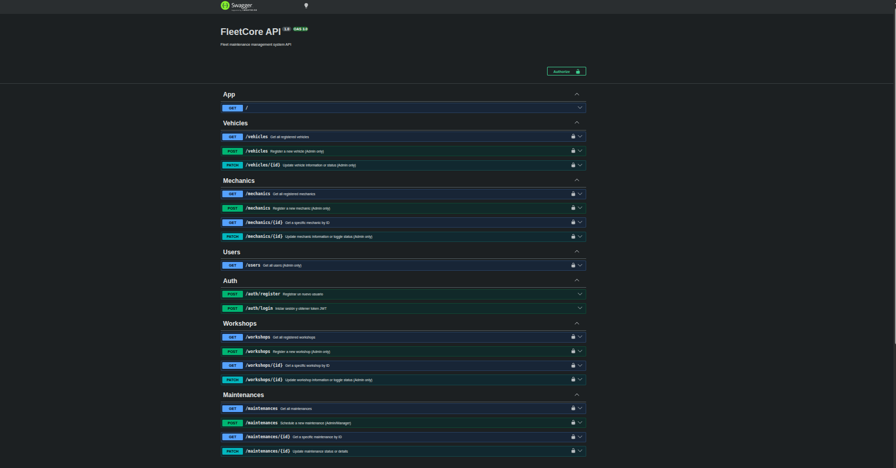

# 🚚 FleetCore API

FleetCore is a robust, production-ready backend maintenance management system designed for vehicle fleets. Built with **NestJS**, **TypeScript** (ES Modules), **PostgreSQL**, and **TypeORM**, it provides comprehensive control over vehicles, mechanics, workshops, maintenance scheduling, and role-based access control (RBAC).

## 🌟 Features & Architecture

The application follows a clean modular architecture located under `src/modules/`:

- **Auth & Users (`/auth`, `/users`):** Secure authentication using JWT and role-based access control (Admin, Mechanic, Operator).

- **Vehicles (`/vehicles`):** Full fleet inventory tracking including plates, brands, models, mileage, and vehicle statuses.

- **Mechanics (`/mechanics`):** Management of specialized mechanics, tracking their competencies and availability.

- **Workshops (`/workshops`):** Centralized directory and facility management for physical repair shops.

- **Maintenances (`/maintenances`):** Core business logic handling preventive/corrective maintenance lifecycles, date validation, and scheduling cross-checks.

## 🛠️ Tech Stack

- **Framework:** [NestJS](https://nestjs.com/)

- **Language:** TypeScript

- **Database & ORM:** PostgreSQL & TypeORM

- **Testing Framework:** [Vitest](https://vitest.dev/) (Achieving over **60% total code coverage**)

- **API Documentation:** OpenAPI / Swagger UI

## ⚙️ Installation & Getting Started

### Prerequisites

- **Node.js** (v18+ recommended)

- **PostgreSQL** installed and running locally or inside a container.

### Step-by-Step Setup

1. **Clone the repository:**

   ```
   git clone https://github.com/KevinMercado1/fleet-core.git
   cd fleet-core

   ```

2. **Install dependencies:**

   ```
   npm install

   ```

3. **Configure Environment Variables:**
   Duplicate `.env.example` to create your local `.env` file:

   ```
   cp .env.example .env

   ```

   Update the credentials according to your local PostgreSQL setup (database name, user, password, port).

4. **Run Database Seeders / Migrations:**
   To populate the database with initial relational testing data:

   ```
   npm run seed

   ```

5. **Run the Application:**

   ```
   # Development mode with hot-reload
   npm run start:dev

   # Production build and start
   npm run build
   npm run start:prod

   ```

## 📄 Environment Variables (`.env.example`)

Make sure your configuration mirrors this structure:

```
PORT=3000
DB_HOST=localhost
DB_PORT=5432
DB_USER=postgres
DB_PASSWORD=your_password
DB_NAME=fleet_core
JWT_SECRET=your_super_secret_jwt_key

```

## 📦 Database Dump (`.sql`)

A complete `.sql` backup file containing the database schema, foreign key relations, constraints, and seed data is included in the project repository and uploaded to Moodle for evaluation. You can restore it directly into your PostgreSQL server:

```
psql -U postgres -d fleet_core -f database_dump.sql

```

## 📖 Swagger API Documentation

Once the application is running, you can explore, test, and interact with all endpoints directly through the interactive Swagger UI:

👉 **URL:** `http://localhost:3000/api`

### Test Credentials (Default Admin)

- **Email:** `admin@fleetcore.com`

- **Password:** `password123`

## 🧪 Testing & Code Coverage

The project features a comprehensive test suite covering unit tests (services and controllers) and E2E integration tests powered by **Vitest**:

```
# Run unit and controller tests
npm run test

# Run tests with code coverage report (>60% overall line coverage)
npx vitest run --coverage

# Run End-to-End integration tests
npm run test:e2e

```

## 📸 Evidencias de Pruebas (Swagger UI)

A continuación se muestra la interfaz interactiva de Swagger documentando todos los endpoints operativos de la API:



## 📋 Submission Deliverables Reference

1. **Source Code:** Fully functional NestJS API repository.

2. **README.md:** Complete setup guidelines, technical overview, and metadata.

3. **Environment Template:** `.env.example` file provided.

4. **Database Dump:** `.sql` backup file provided for Moodle submission.

5. **Swagger Documentation:** Available live at `/api`.

6. **Testing & Validation:** Verified with Vitest test suites and Postman/Swagger scenarios.

## 👨‍💻 Author & Clan

- **Coder:** Kevin Mercado

- **Clan:** Centurion
